<div align="center">

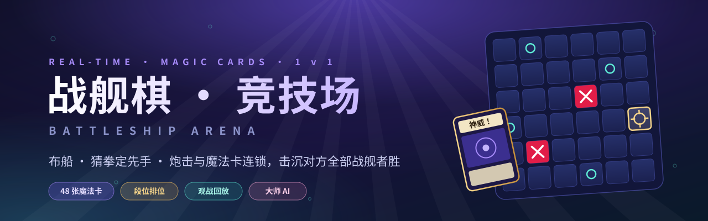

<br>

**6×6 海域 × 48 种魔法卡 × 连锁对决 —— 支持双人联机、四档人机与卡牌收集的海战棋**

<p>
  
  
  
  
  
  
</p>

<p>
  <a href="http://8.133.180.159:5000/"><b>🎮 在线试玩</b></a> ·
  <a href="#-游玩与下载"><b>📥 客户端</b></a> ·
  <a href="#-快速开始"><b>🚀 本地运行</b></a> ·
  <a href="#-魔法卡"><b>🃏 魔法卡</b></a> ·
  <a href="#-功能一览"><b>✨ 功能</b></a> ·
  <a href="./docs"><b>📚 设计文档</b></a>
</p>

</div>

<br>

<p align="center">
  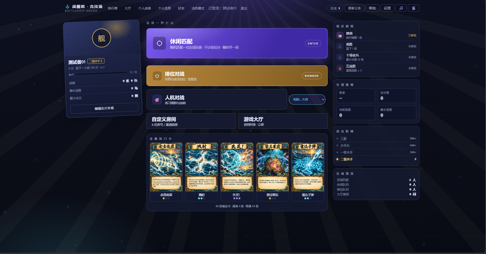
</p>

---

## 🌊 这是什么

在 6×6 的海域里藏好你的 **6 艘战舰**，猜拳决定先手，然后轮流开炮 —— 先击沉对方全部战舰的人获胜。

听起来是小时候的纸笔游戏？再加上 **48 种魔法卡**：冻结敌舰、3×3 区域放逐、整行轰炸、偷看对方手牌、改写全场规则的场地魔法……
对手出牌时，你还可以用速阶 3 的卡**连锁响应**，把局势在一瞬间翻过来。

> [!TIP]
> 不想注册也能以游客身份直接匹配；想冲段位就登录打 **排位对战**。

---

## 📥 游玩与下载

无需安装，打开 **[在线试玩](http://8.133.180.159:5000/)** 即可开始。电脑和手机使用同一套账号；进入「开战」可直接选择四档人机，也可以休闲匹配、排位或邀请好友进自定义房间。

| 方式 | 入口 |
|:--|:--|
| 浏览器 | [打开战舰棋](http://8.133.180.159:5000/) |
| Windows | [下载安装包](http://8.133.180.159:5000/static/clients/battleship-setup.exe) |
| Android | [下载 APK](http://8.133.180.159:5000/static/clients/battleship.apk) |
| 本地源码运行 | 见下方[快速开始](#-快速开始) |

游客适合快速试一局；**排位、图鉴进度、成就奖励、签到和通行证等账号功能需登录**。下载安装包也可以使用游戏内的下载入口。

---

## 📸 游戏画面

以下保留现有实机截图，展示对战、大厅、结算与回放。开战页、航海图鉴等新界面的截图正在补充。

<table>
  <tr>
    <td width="50%">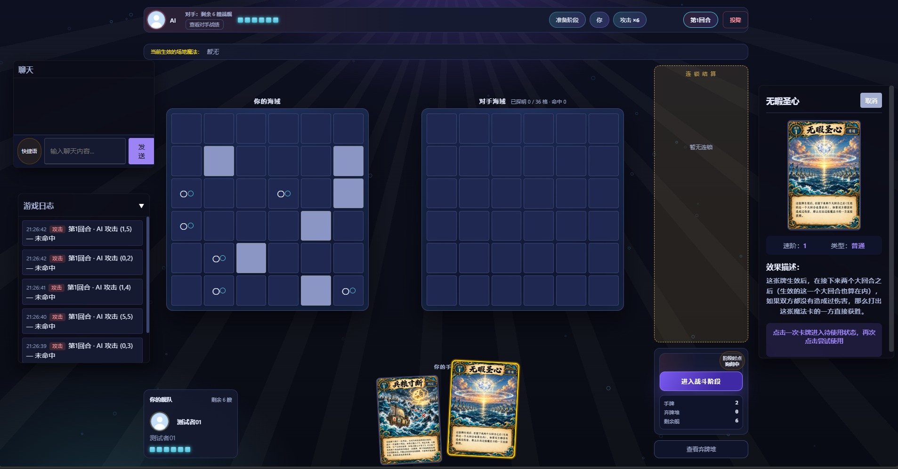<p align="center"><sub><b>对局</b> · 双方海域 / 游戏日志 / 手牌与完整卡面</sub></p></td>
    <td width="50%">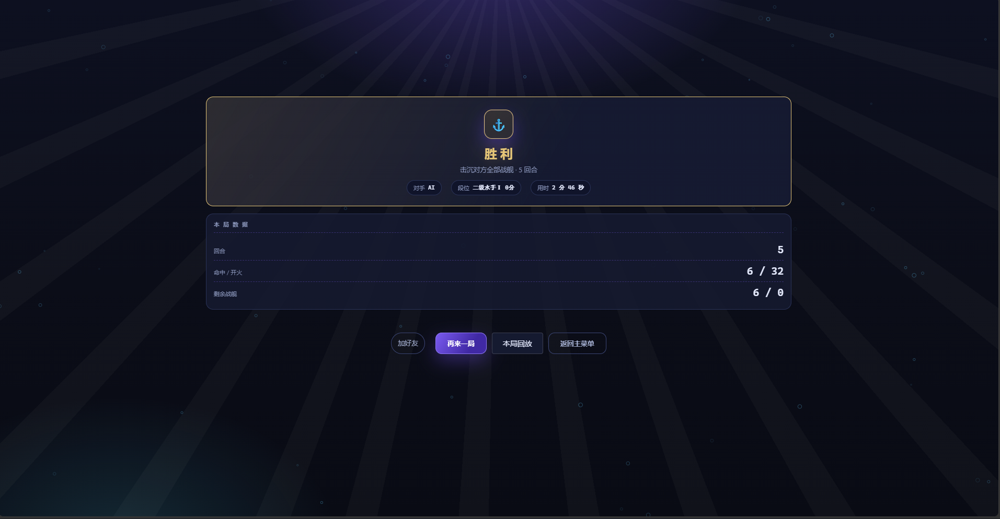<p align="center"><sub><b>结算</b> · 胜负判定 / 本局数据 / 再来一局 / 回放入口</sub></p></td>
  </tr>
  <tr>
    <td>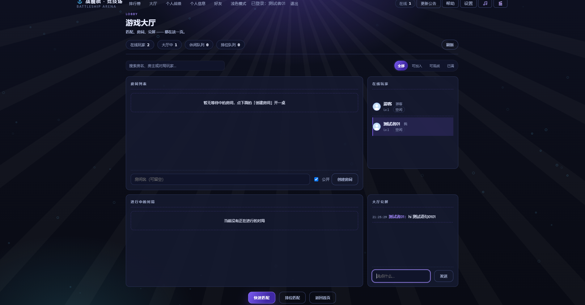<p align="center"><sub><b>游戏大厅</b> · 房间列表 / 在线玩家 / 大厅公屏</sub></p></td>
    <td>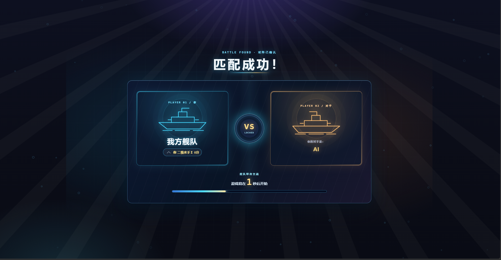<p align="center"><sub><b>匹配成功</b> · 双方舰队 / 段位信息 / 开局倒计时</sub></p></td>
  </tr>
  <tr>
    <td>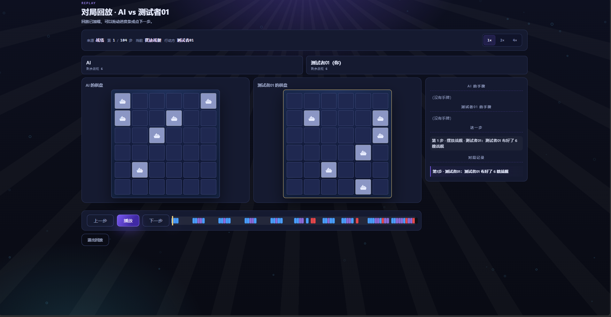<p align="center"><sub><b>对局回放</b> · 逐步回看 / 倍速控制 / 关键节点</sub></p></td>
    <td>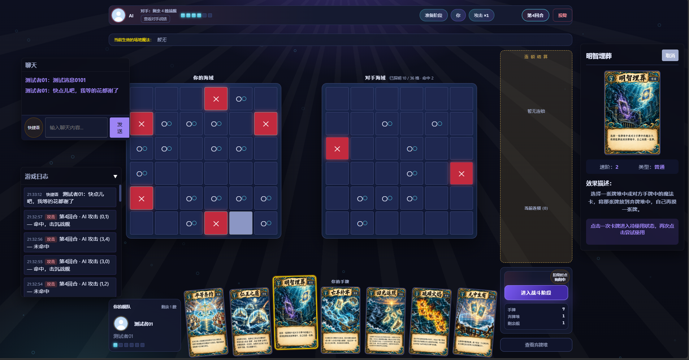<p align="center"><sub><b>卡面适配</b> · 手牌完整卡面 / 目标卡详情 / 游戏日志</sub></p></td>
  </tr>
</table>

---

## 🎯 玩法

```text
  ┌─────────┐    ┌───────────┐    ┌──────────────────────────────────┐    ┌────────┐
  │  布 船  │ ─▶ │ 猜拳定先手 │ ─▶ │ 准备阶段 ─▶ 战斗阶段 ─▶ 结束阶段 │ ─▶ │  胜 负  │
  │ 6 艘单格 │    │ 先手抽1张  │    │   出牌       开炮        交回合   │    │ 全灭即负 │
  └─────────┘    │ 后手抽2张  │    └───────────────▲──────┬──────────┘    └────────┘
                 └───────────┘                    └──────┘ 轮流进行
```

- 通常 **攻击次数 = 存活战舰数 − 被冻结的战舰数**；场地和其他卡牌效果可以改变火力。
- **速阶 1 / 2** 通常在自己回合的准备、战斗阶段打出；「Freezing！」只在满足条件的先手结束阶段发动。**速阶 3** 可以在双方回合使用，包括对方出牌时的**连锁响应**；具体仍受卡牌发动条件和禁牌效果限制。
- 连锁按**后进先出**结算，每次响应窗口 10 秒；「失灵！」「平等条约」能直接无效化栈中下方那张卡。
- **场地魔法**全场同时只能存在一张，后来者顶替前者。
- 回合思考时间默认 90 秒，超时只做保底动作（进入战斗 / 随机开一炮 / 交回合），**不会判负**。

---

## 🃏 魔法卡

<p align="center">
  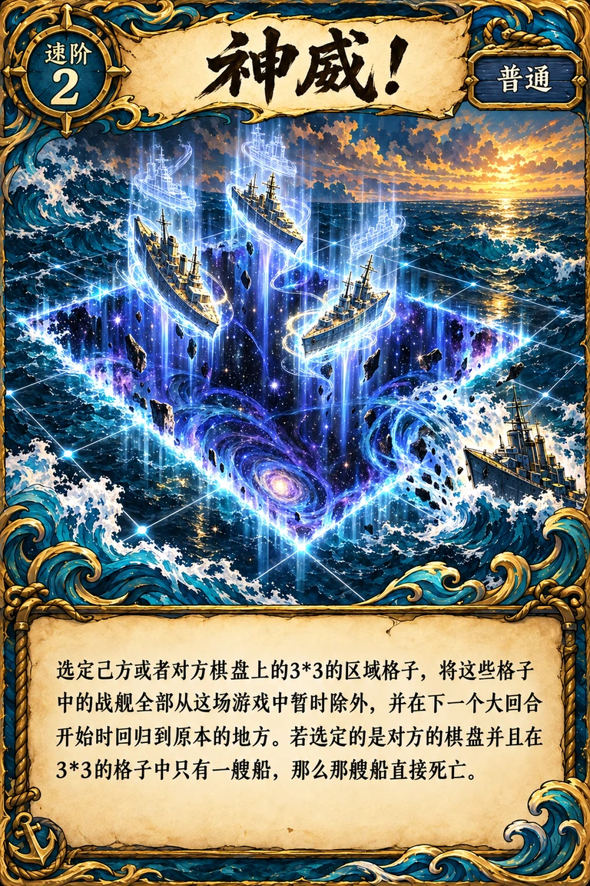
  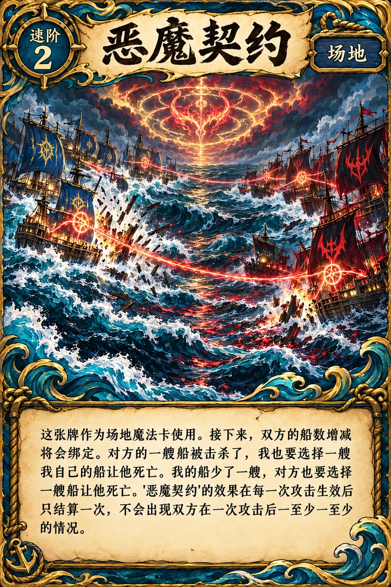
  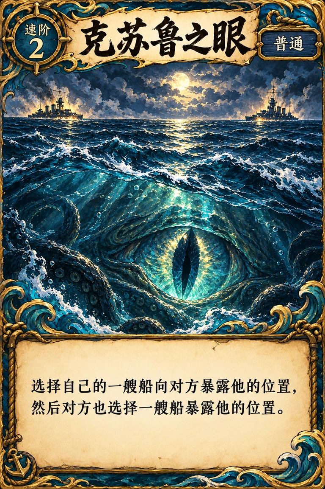
  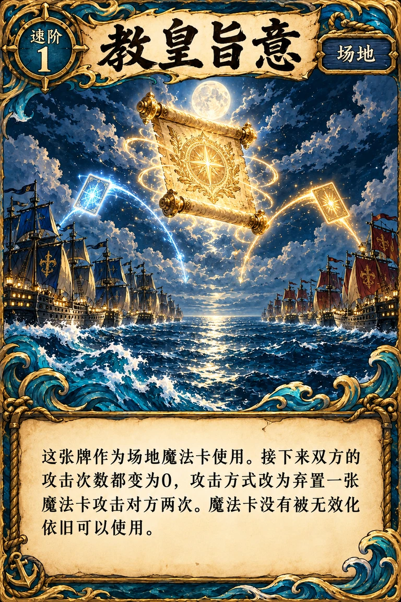
  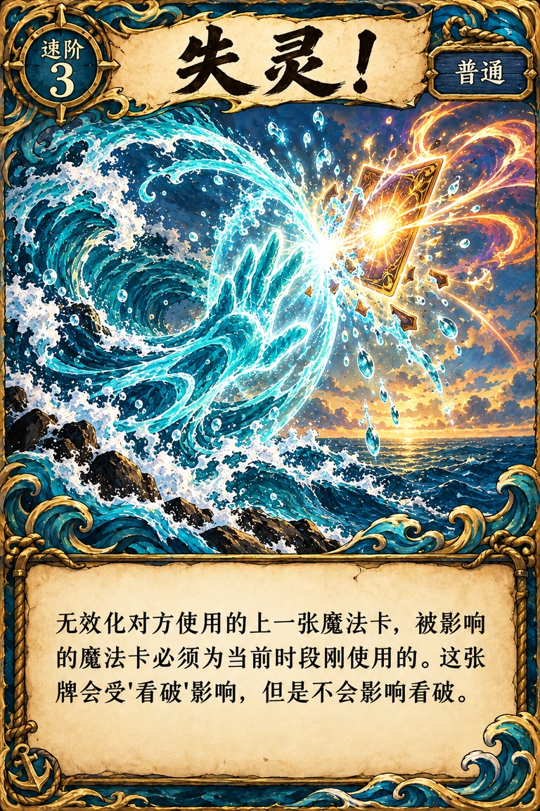
</p>

卡池共 **50 张 / 48 种**（「失灵！」有 3 张），每一张都有独立绘制的完整卡面。

| 类别 | 速阶 | 数量 | 代表卡牌 |
|:--|:--:|:--:|:--|
| ⚔️ 普通 | 1 | 13 | 仁王之盾 · 火力全开 · 桃园结义 · 败者食尘 · 回光返照 |
| ⚔️ 普通 | 2 | 14 | 神威！ · 冻结 · 轰炸 · 探测雷达 · 克苏鲁之眼 · 溅射 |
| ⚡ 普通（可连锁） | 3 | 16 | 失灵！×3 · 平等条约 · 神机妙算 · 绝处逢生 · 加百列之光 |
| 🌀 场地 | 1–2 | 4 | 恶魔契约 · 禁忌果实 · 伊甸园 · 教皇旨意 |
| 🎲 判定 | 1 | 3 | 命运骰子 · 无忧梦呓 · 兵粮寸断 |

<details>
<summary><b>几张值得一提的卡</b></summary>

<br>

| 卡牌 | 效果 |
|:--|:--|
| **神威！** | 选定任一方 3×3 区域，其中战舰暂时离场；若是对方棋盘且只框住一艘船，那艘船直接沉没 |
| **恶魔契约** | 场地：双方船数绑定，我沉一艘你也得沉一艘 |
| **教皇旨意** | 场地：攻击次数归零，改为弃一张魔法卡换两次攻击 |
| **伊甸园** | 场地：每回合攻击次数变为 `6 − 自身战舰数`，越劣势越凶 |
| **禁忌果实** | 场地：除「失灵！」与其他场地卡外，双方都不能出牌 |
| **败者食尘** | 立即重开对局，但双方保留手牌 |
| **绝处逢生** | 自己至少有 3 艘战舰时，牺牲舰队并重部署唯一一艘；之后击沉对方一艘即判胜 |

</details>

---

## ✨ 功能一览

<table>
<tr>
<td width="50%" valign="top">

### ⚔️ 对战
- **休闲匹配 / 排位对战** —— 自动配对
- **人机对战** —— 简单 · 普通 · 困难 · **大师** 四档
- **排位 Ban** —— 随段位解锁禁牌名额，开战前可预选
- **周常突变** —— 在原有对局规则上体验轮换的特殊条件
- **每日挑战** —— 对阵大师的固定残局，按当天已发布关卡开放
- **自定义房间** —— 6 位房号 + 一键复制邀请链接
- **游戏大厅** —— 房间列表、在线玩家、公屏聊天
- **好友** —— 加好友、私聊、邀请对战
- **断线重连** —— 30 秒宽限，整局状态完整恢复

</td>
<td width="50%" valign="top">

### 🏆 成长与收藏
- **排位与赛季** —— 从二级水手到大舰长，查看当季成绩与排行榜
- **等级经验** —— 对局结算展示经验与升级进度
- **航海图鉴** —— 48 种卡牌，可搜索、筛选、查看效果与点亮进度
- **卡牌熟练光效** —— 四档可选，也可关闭；达到宗师熟练度可获专属称号
- **12 项航海成就** —— 连胜、断链、深潜连锁、孤舰翻盘等目标与奖励
- **签到与每日 / 每周任务** —— 获取潮汐徽记，任务同时推进通行证经验
- **赛季通行证与商店** —— 领取赛季奖励、购买外观，邮件接收奖励附件

</td>
</tr>
<tr>
<td valign="top">

### 👀 观看
- **实时观战** —— 每局最多 20 名观众，独立观战席聊天
- **对局回放** —— 从战绩一键回看，支持倍速与关键节点跳转
- **隐私设置** —— 控制战绩、回放和观战等公开范围
- **个人名片** —— 展示段位、徽章与称号，搭配头像框、背景和称号特效

</td>
<td valign="top">

### 🎨 体验
- **响应式界面** —— 开战页、对战、图鉴与设置适配桌面和手机
- **三种主题** —— 航图、航海日志、夜航，支持减少动态效果
- **外观装饰** —— 资料背景、指针轨迹、称号光效与完整卡面
- **动态壁纸** —— 本机运行时扫描壁纸库，使用可用的视频 / 图片壁纸
- **音效与背景音乐** —— 采样音效与合成音效结合，待命 / 对局循环音乐，终局叠加氛围层
- **局内快捷语** · **更新公告** · **好友私聊**

</td>
</tr>
</table>

### 🃏 图鉴、熟练与成就如何推进

在「图鉴」查看已点亮的卡牌、卡牌使用次数与航海成就。点亮卡牌、完成收集里程碑或成就后，奖励会自动结算；熟练光效解锁后由自己选择，不会自动开启。

| 对局类型 | 点亮图鉴 | 累计熟练与新航海成就 |
|:--|:--:|:--:|
| 有效休闲匹配、排位 | ✓ | ✓ |
| 人机、每日挑战 | ✓ | — |
| 自定义、取消局、管理员测试局 | — | — |

这些进度从功能上线后的有效对局开始累计，**不回填旧战绩**；旧个人资料徽章仍独立保留。完整口径见[图鉴与成就说明](docs/COLLECTION_ACHIEVEMENTS_V1.md)。

### 🤖 关于「大师」AI

大师档会**试算每张候选卡的结果再挑最优**、交错出牌、每回合最多打 3 张，并根据已暴露的情报决定开炮位置。
历史固定种子自对弈报告中，**大师 vs 困难 = 75.00%**（25 000 局，95% CI 74.46–75.53）。这是当时版本的离线结果，不代表当前版本或真人对局的胜率。
详细的决策层设计与逐项消融数据见 [`docs/MASTER_AI_2026_09_21.md`](docs/MASTER_AI_2026_09_21.md)。

---

## 🚀 快速开始

> [!IMPORTANT]
> 需要 **Git、Python 3.12+、Node.js 20+ 与 pnpm 9+**。没有 pnpm 时可先运行 `npm install --global pnpm@9`。以下两套命令任选其一，克隆后均在项目根目录执行。

### Windows PowerShell

```powershell
git clone https://github.com/xiaoxiaoyiiii/battle_ship1.0.git
cd battle_ship1.0
python -m venv .venv
$py = ".\.venv\Scripts\python.exe"

& $py ops/build.py
$env:SECRET_KEY = & $py -c "import secrets; print(secrets.token_hex(32))"
& $py ops/run_stack.py --host 127.0.0.1 --port 5000 --db ./.tmp/local.db
```

这里直接使用虚拟环境中的解释器，不需要运行 `Activate.ps1`。

### macOS / Linux

```bash
git clone https://github.com/xiaoxiaoyiiii/battle_ship1.0.git
cd battle_ship1.0
python3 -m venv .venv
.venv/bin/python ops/build.py
export SECRET_KEY="$(.venv/bin/python -c 'import secrets; print(secrets.token_hex(32))')"
.venv/bin/python ops/run_stack.py --host 127.0.0.1 --port 5000 --db ./.tmp/local.db
```

打开 **<http://127.0.0.1:5000/>**，选择人机即可试玩。测试双人对局请使用两个不同浏览器，或一个普通窗口加一个无痕窗口，避免同一登录会话共享身份。一个窗口在大厅创建房间，另一个窗口输入房号或打开邀请链接加入，再由双方准备开局。

`ops/build.py` 安装后端依赖、安装并构建前端，同时校验构建产物与 48 张卡图。`ops/run_stack.py` 自动创建 / 迁移指定的本地数据库，再由同一个服务提供网页、接口和实时对局；本地健康检查为 <http://127.0.0.1:5000/health>。

示例随机密钥用于本地试玩；关闭终端后重新生成会使旧登录失效。长期运行时，应通过自己的环境配置**固定保存** `SECRET_KEY`，不要将密钥提交到 Git。存档位于 `.tmp/local.db`，以后继续使用同一路径即可保留进度。

### 常见启动问题

| 现象 | 处理 |
|:--|:--|
| 提示缺少 `SECRET_KEY` | 在启动服务的同一终端执行上面的密钥设置命令 |
| 提示找不到 `frontend/dist/index.html` | 先成功运行 `ops/build.py`，再启动服务 |
| 提示找不到 pnpm 或 Python 版本不足 | 核对工具是否在当前终端的 PATH 中，Python 需为 3.12 或以上 |
| 端口 5000 已占用 | 改用其他空闲端口，并为该端口设置 `CORS_ORIGINS` 后重新启动 |
| 每日挑战显示「今日暂无」 | 源码仓库的关卡清单默认为空；运营需配置当天的私有关卡，普通对局不受影响 |

默认只监听本机。需要局域网访问时，显式指定 `--host 0.0.0.0`，并将实际访问来源加入 `CORS_ORIGINS`；不要把 `0.0.0.0` 当作浏览器地址。

### 测试与门禁

修改前端时，可在项目根目录执行：

```bash
pnpm --dir frontend typecheck
pnpm --dir frontend build
```

构建会检查卡表同步和前后端契约。完整的集成回归、浏览器脚本和截图基线由维护者在仓外保存、单独分发。验证约定见 [`CLAUDE.md`](CLAUDE.md#验证与门禁)。

本地运行与生产部署分开处理。部署、备份和迁移入口见 [`ops/README.md`](ops/README.md)；升级已有实例前先备份数据库，回退代码与恢复数据需分别评估。

### 环境变量

| 变量 | 默认 | 说明 |
|:--|:--|:--|
| `SECRET_KEY` | —（必填） | 会话签名密钥；缺失或为空启动即失败 |
| `HOST` / `PORT` | 由启动方式决定 / `5000` | 本文显式指定 `127.0.0.1`；直接运行后端默认监听 `0.0.0.0` |
| `CORS_ORIGINS` | `http://localhost:5000,http://127.0.0.1:5000` | 允许的来源，多个地址用逗号分隔 |
| `BATTLESHIP_DB_PATH` | `./battleship.db` | SQLite 数据库路径（WAL） |
| `TURN_TIMEOUT_SECONDS` | `90` | 回合思考时间，`0` 关闭 |
| `CHAIN_DISPLAY_DELAY_SECONDS` | `1.2` | 连锁展示停留；测试置 0 |
| `FRONTEND_DIST` | `frontend/dist` | 可选：覆盖前端构建产物位置 |
| `DAILY_PUZZLES_PATH` | `config/daily_puzzles.json` | 每日挑战私有清单；仓库默认无已发布关卡 |
| `BATTLESHIP_WALLPAPER_ALLOW_REMOTE` | — | 设 `1` 允许非本机访问时扫描壁纸库 |
| `ENABLE_TEST_EVENTS` | `0` | 仅本地调试 / E2E 用，**生产切勿开启** |

---

## 🧱 架构

```text
 浏览器（Vue 3 SPA，frontend/dist）
   │  ▲
   │  │  Socket.IO（实时对局 / 大厅 / 观战）      HTTP（账号 / 排行 / 回放 / 公告）
   ▼  │                                                  │
 uvicorn ── FastAPI（backend/src/battleship）             │
   ├── realtime/     Socket.IO handlers / emitter          │
   ├── http/         REST 路由 + SPA 与头像托管             │
   ├── services/     对局、结算、成长与奖励用例编排         │
   ├── domain/       纯规则（无框架/无数据库）              │
   └── repositories/ SQLAlchemy + Alembic ────────────────┘
   ▼
 SQLite（WAL）
```

**核心规则由服务端执行**：对局、魔法与连锁、段位、任务奖励、图鉴和隐私过滤不依赖客户端自行判定。前端读取授权状态，负责展示和交互。

| 目录 | 职责 |
|:--|:--|
| `backend/src/battleship/contracts/` | Pydantic 模型、事件清单、JSON Schema（唯一契约来源） |
| `backend/src/battleship/domain/` | 对局状态机、魔法/连锁、AI、成长、赛季与收藏规则 |
| `backend/src/battleship/services/` | 对局、任务、图鉴、结算等用例与事务编排 |
| `backend/src/battleship/repositories/` | SQLAlchemy 模型与迁移（唯一 SQL 位置） |
| `backend/src/battleship/realtime/` · `http/` | Socket.IO 与 REST 协议适配、SPA 托管 |
| `backend/src/battleship/infra/` | 配置、结构化日志、指标、健康检查、限流 |
| `frontend/src/screens/` · `stores/` · `realtime/` | 游戏页面、Pinia 状态与实时通信适配 |
| `frontend/public/card_faces/` | 48 张卡面（构建期打包为内容哈希资产） |
| `ops/` | 构建、迁移、健康检查、备份与 systemd 部署模板 |
| `static/avatars/` | 玩家头像（唯一保留的旧 `static/` 数据，冻结 URL） |

---

## 🔐 安全设计

- 密码使用 Werkzeug 加盐哈希；登录 / 注册 / 改密带 IP 限流；头像上传限 2 MB 并校验文件魔数。
- 对局操作校验身份、座位与当前连接；胜负、次数和奖励由服务端计算。
- 观战与回放复用服务端公开投影，按访问权限过滤船位、手牌等隐藏信息。
- 排位结算包含反作弊判据，人机、自定义和管理员测试局不计排位分。
- 图鉴进度从合法出牌事实采集，奖励与结算记录进行幂等处理。
- 壁纸扫描与本机路径导入**默认仅限回环地址**访问；维护者可显式配置远程壁纸库访问，日常线上游玩无需开启。

---

## 📚 延伸阅读

| 文档 | 内容 |
|:--|:--|
| [`CLAUDE.md`](CLAUDE.md) | 面向开发者 / AI 代理的新架构索引与旧栈教训 |
| [`docs/REWRITE_LANDING_2026_10_20.md`](docs/REWRITE_LANDING_2026_10_20.md) | 重写落地：架构、契约、门禁、回滚、残余 |
| [`docs/adr/0001-modern-rewrite.md`](docs/adr/0001-modern-rewrite.md) | 重写决策与替代方案 |
| [`ops/README.md`](ops/README.md) | 构建 / 迁移 / 部署 / 5 分钟回滚 runbook |
| [`docs/CHAIN_ENGINE_SPEC.md`](docs/CHAIN_ENGINE_SPEC.md) | 连锁引擎规格 |
| [`docs/RANKED_2026_09_17.md`](docs/RANKED_2026_09_17.md) | 段位与排位系统 |
| [`docs/MASTER_AI_2026_09_21.md`](docs/MASTER_AI_2026_09_21.md) | 大师 AI 设计与度量 |
| [`docs/COLLECTION_ACHIEVEMENTS_V1.md`](docs/COLLECTION_ACHIEVEMENTS_V1.md) | 航海图鉴、成就、熟练光效与进度口径 |
| [`docs/SEASON_MAILBOX_V1.md`](docs/SEASON_MAILBOX_V1.md) | 赛季结算、玩家邮箱与运营约定 |
| [`docs/DAILY_CHALLENGE_V1.md`](docs/DAILY_CHALLENGE_V1.md) | 每日挑战及私有关卡配置 |
| [`docs/superpowers/specs/2026-10-29-season-pass-design.md`](docs/superpowers/specs/2026-10-29-season-pass-design.md) | 通行证、任务与外观奖励设计 |
| [`docs/REPLAY_SPECTATE_V2.md`](docs/REPLAY_SPECTATE_V2.md) | 当前回放、观战与隐私投影 |
| [`docs/WALLPAPER_ENGINE.md`](docs/WALLPAPER_ENGINE.md) | 动态壁纸实现与安全模型 |
| [`docs/DEPLOYMENT.md`](docs/DEPLOYMENT.md) | 历史部署事故记录（旧栈）；现行步骤看 ops |

---

<div align="center">

<sub>个人学习 / 娱乐项目 · 卡牌名称与效果灵感来自各类卡牌游戏，仅供交流学习</sub>

<sub>⚓ 祝你炮炮命中</sub>

</div>
